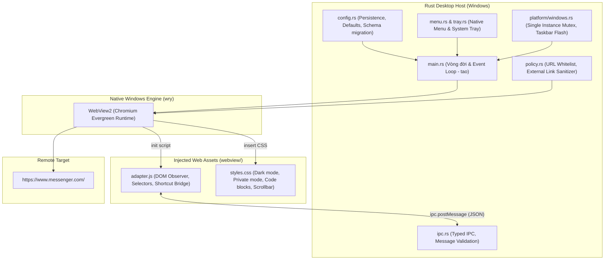

# Kiến trúc Caprine Rust Desktop Host (Windows Exclusive)

Tài liệu này xác định kiến trúc, lựa chọn công nghệ, mô hình bảo mật và ranh giới hệ thống cho bản chuyển đổi Caprine sang **Windows** bằng Rust thuần.

---

## 1. Công nghệ lựa chọn

- **Windowing & Khay hệ thống**: `tao` (v0.28).
- **Web Rendering Engine**: `wry` (v0.40) tích hợp native **Microsoft Edge WebView2** trên Windows.
- **Windows Native APIs**: `windows-sys` (v0.52) hỗ trợ Win32 Named Mutex chống mở nhiều phiên bản và `FlashWindowEx` nhấp nháy taskbar khi có tin nhắn mới.
- **MSRV (Minimum Supported Rust Version)**: `1.75.0`
- **Target**: `x86_64-pc-windows-msvc` (Rust 1.80.0 được pin trong `rust-toolchain.toml`).

---

## 2. Kiến trúc tổng thể

---

## 3. Ranh giới bảo mật & Dữ liệu trên Windows

1. **Loại bỏ hoàn toàn `nodeIntegration`**: Không cấp quyền Node.js hay shell execution cho trang web.
2. **Context Isolation**: Giao tiếp chỉ qua kênh IPC JSON có kiểm tra chặt chẽ (`ipc.rs`).
3. **Chính sách điều hướng**: Giới hạn trong `messenger.com`, `facebook.com/checkpoint` (2FA), `workplace.com`. Mọi liên kết ngoài được khử `fbclid` và mở bằng trình duyệt mặc định hệ thống.
4. **Vị trí cấu hình**: Lưu độc lập tại `%APPDATA%\CaprineRust\config.json`, không làm bẩn dữ liệu của bản Caprine Electron cũ tại `%APPDATA%\Caprine`.
